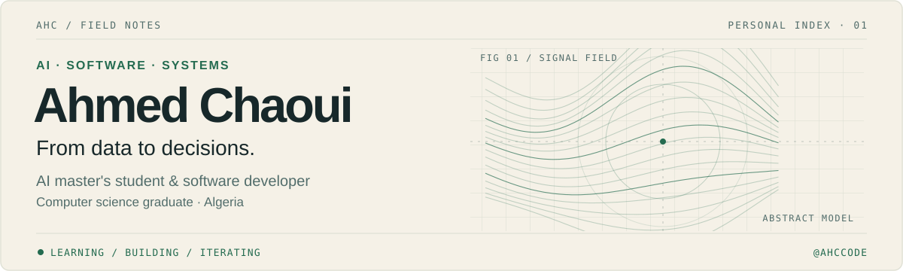
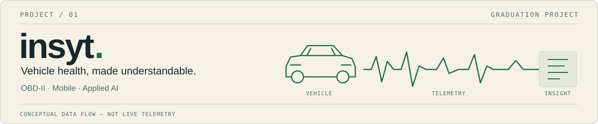

<picture>
  <source media="(prefers-color-scheme: dark)" srcset="assets/header-dark.svg">
  <source media="(prefers-color-scheme: light)" srcset="assets/header-light.svg">
  
</picture>

[**Work**](#01--selected-work) · [**Toolkit**](#02--toolkit) · [**Study notes**](#03--currently-exploring) · [**GitHub**](https://github.com/AHCCode)

I’m a computer science graduate from Algeria, currently pursuing a Master’s in Artificial Intelligence at Université Mustapha Stambouli, Mascara. I like building software that takes complex information and makes it useful — whether it comes from a vehicle, a database or a machine learning model.

## 01 / Selected work

<picture>
  <source media="(prefers-color-scheme: dark)" srcset="assets/insyt-dark.svg">
  <source media="(prefers-color-scheme: light)" srcset="assets/insyt-light.svg">
  
</picture>

**Insyt — intelligent vehicle health monitoring**

My graduation project explores how vehicle data and intelligent diagnostics can make car maintenance more approachable. It combines OBD-II connectivity, mobile development and AI-assisted explanations.

- Live vehicle telemetry and diagnostic trouble code interpretation
- Rule-based diagnostics with AI-assisted explanations
- Interfaces for both everyday drivers and more experienced users

`Flutter` · `Dart` · `Firebase` · `OBD-II` · `Bluetooth`

## 02 / Toolkit

| Area | Languages & tools |
| :--- | :--- |
| Application development | Flutter · Dart · Kotlin · Android Studio |
| Data & backend | SQL · PostgreSQL · Firebase |
| Machine learning (learning) | Python · NumPy · pandas · scikit-learn · Jupyter |
| Development workflow | Git · GitHub · VS Code |

## 03 / Currently exploring

- Machine learning and model evaluation
- Knowledge representation, reasoning and intelligent systems
- Algorithms, optimization and AI-assisted software development

My aim is to build systems that are not only technically sound, but genuinely useful to the people who use them.

---

AHC / FIELD NOTES · [AHCCode](https://github.com/AHCCode) · Algeria
