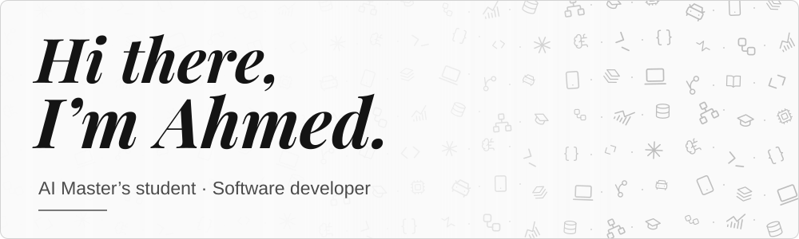
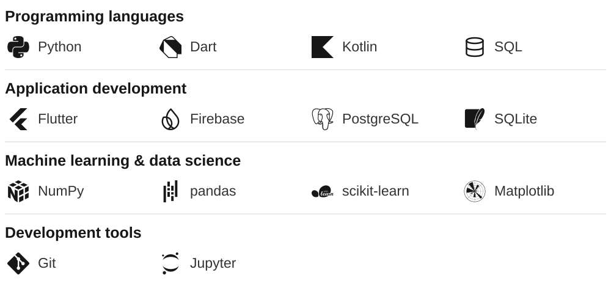

<picture>
  <source media="(prefers-color-scheme: dark)" srcset="assets/doodle/hero-dark.svg">
  <source media="(prefers-color-scheme: light)" srcset="assets/doodle/hero-light.svg">
  
</picture>

<picture>
  <source media="(prefers-color-scheme: dark)" srcset="assets/doodle/about-dark.svg">
  <source media="(prefers-color-scheme: light)" srcset="assets/doodle/about-light.svg">
  
</picture>

<h3>Computer Science graduate &amp; AI Master's student.</h3>

Currently studying at **Université Mustapha Stambouli, Mascara, Algeria.**

I'm interested in artificial intelligence, software engineering and building mobile applications that solve real-world problems.

<a href="https://www.linkedin.com/in/chaoui-ahmed/"><picture><source media="(prefers-color-scheme: dark)" srcset="assets/doodle/linkedin-outline-dark.svg"><source media="(prefers-color-scheme: light)" srcset="assets/doodle/linkedin-outline-light.svg"></picture></a>

 

<picture>
  <source media="(prefers-color-scheme: dark)" srcset="assets/doodle/project-dark.svg">
  <source media="(prefers-color-scheme: light)" srcset="assets/doodle/project-light.svg">
  
</picture>

<picture>
  <source media="(prefers-color-scheme: dark)" srcset="assets/doodle/insyt-dark.svg">
  <source media="(prefers-color-scheme: light)" srcset="assets/doodle/insyt-light.svg">
  
</picture>

<h3>Insyt is my graduation project — an intelligent vehicle health monitoring app.</h3>

It helps drivers understand their cars through real-time OBD-II data, diagnostic trouble codes and AI-assisted explanations.

<picture>
  <source media="(prefers-color-scheme: dark)" srcset="assets/doodle/insyt-stack-inline-v2-dark.svg">
  <source media="(prefers-color-scheme: light)" srcset="assets/doodle/insyt-stack-inline-v2-light.svg">
  
</picture>

 

<picture>
  <source media="(prefers-color-scheme: dark)" srcset="assets/doodle/technical-stack-heading-dark.svg">
  <source media="(prefers-color-scheme: light)" srcset="assets/doodle/technical-stack-heading-light.svg">
  
</picture>

<picture>
  <source media="(prefers-color-scheme: dark)" srcset="assets/doodle/technical-stack-v3-dark.svg">
  <source media="(prefers-color-scheme: light)" srcset="assets/doodle/technical-stack-v3-light.svg">
  
</picture>

 

<picture>
  <source media="(prefers-color-scheme: dark)" srcset="assets/doodle/currently-dark.svg">
  <source media="(prefers-color-scheme: light)" srcset="assets/doodle/currently-light.svg">
  
</picture>

<h3><picture><source media="(prefers-color-scheme: dark)" srcset="assets/doodle/current-learning-dark.svg"><source media="(prefers-color-scheme: light)" srcset="assets/doodle/current-learning-light.svg"></picture>&nbsp; Learning</h3>

Machine learning, knowledge representation and intelligent systems.

<h3><picture><source media="(prefers-color-scheme: dark)" srcset="assets/doodle/current-building-dark.svg"><source media="(prefers-color-scheme: light)" srcset="assets/doodle/current-building-light.svg"></picture>&nbsp; Building</h3>

Improving Insyt and developing mobile applications.

<h3><picture><source media="(prefers-color-scheme: dark)" srcset="assets/doodle/current-studying-dark.svg"><source media="(prefers-color-scheme: light)" srcset="assets/doodle/current-studying-light.svg"></picture>&nbsp; Studying</h3>

Master’s degree in Artificial Intelligence.

<!-- Main title: Playfair Display Bold Italic (SIL Open Font License), converted to SVG outlines. Technology logos: https://github.com/simple-icons/simple-icons. Doodle motifs inspired by Lucide icons. -->
