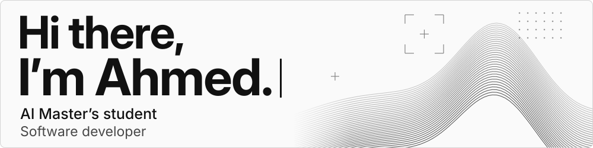

<picture>
  <source media="(prefers-color-scheme: dark)" srcset="assets/mono/hero-dark.svg">
  <source media="(prefers-color-scheme: light)" srcset="assets/mono/hero-light.svg">
  
</picture>

## About me

I'm a Computer Science graduate from Algeria, currently pursuing a Master's in Artificial Intelligence at Université Mustapha Stambouli, Mascara.

I'm interested in AI, software engineering and mobile development. I enjoy building practical applications and understanding how things work.

## Featured project

<picture>
  <source media="(prefers-color-scheme: dark)" srcset="assets/mono/insyt-dark.svg">
  <source media="(prefers-color-scheme: light)" srcset="assets/mono/insyt-light.svg">
  
</picture>

**Insyt** is my graduation project, a mobile application for real-time OBD-II vehicle diagnostics, telemetry and AI-assisted explanations. It makes vehicle health information easier to understand for drivers.

`Flutter` · `Dart` · `Firebase` · `Bluetooth` · `OBD-II`

## Technologies & tools

<picture>
  <source media="(prefers-color-scheme: dark)" srcset="assets/mono/tools-dark.svg">
  <source media="(prefers-color-scheme: light)" srcset="assets/mono/tools-light.svg">
  
</picture>

## Currently

- Pursuing my Master's in Artificial Intelligence.
- Working on Insyt and exploring mobile development.
- Learning more about machine learning, reasoning and intelligent systems.

<!-- Technology logos sourced from Simple Icons: https://github.com/simple-icons/simple-icons -->
