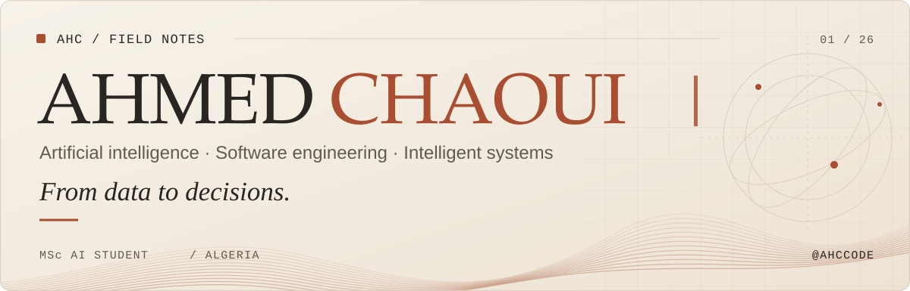
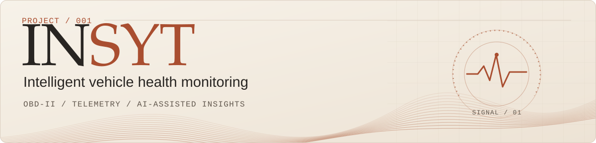

<picture>
  <source media="(prefers-color-scheme: dark)" srcset="assets/editorial/hero-dark.svg">
  <source media="(prefers-color-scheme: light)" srcset="assets/editorial/hero-light.svg">
  
</picture>

  <code>AI &amp; ML</code> &nbsp; / &nbsp;
  <code>MOBILE DEVELOPMENT</code> &nbsp; / &nbsp;
  <code>INTELLIGENT SYSTEMS</code>

<picture>
  <source media="(prefers-color-scheme: dark)" srcset="assets/editorial/about-dark.svg">
  <source media="(prefers-color-scheme: light)" srcset="assets/editorial/about-light.svg">
  
</picture>

I'm a computer science graduate and an Artificial Intelligence Master's student in Algeria. I enjoy building practical software, understanding how systems work and making complex information easier to use.

- **Education:** MSc in Artificial Intelligence · Université Mustapha Stambouli, Mascara
- **Interests:** applied AI, mobile development and intelligent systems

<picture>
  <source media="(prefers-color-scheme: dark)" srcset="assets/editorial/work-dark.svg">
  <source media="(prefers-color-scheme: light)" srcset="assets/editorial/work-light.svg">
  
</picture>

<picture>
  <source media="(prefers-color-scheme: dark)" srcset="assets/editorial/insyt-dark.svg">
  <source media="(prefers-color-scheme: light)" srcset="assets/editorial/insyt-light.svg">
  
</picture>

Insyt is my graduation project: a mobile application that uses vehicle data to make diagnostics more approachable for everyday drivers.

| Capability | What it does |
| :-- | :-- |
| Live telemetry | Reads vehicle data through OBD-II and Bluetooth |
| Diagnostics | Interprets trouble codes and uses rule-based checks |
| AI-assisted insights | Explains diagnostic findings in accessible language |
| Adaptive experience | Offers beginner and expert diagnostic views |

`Flutter` · `Dart` · `Firebase` · `OBD-II`

<picture>
  <source media="(prefers-color-scheme: dark)" srcset="assets/editorial/tools-dark.svg">
  <source media="(prefers-color-scheme: light)" srcset="assets/editorial/tools-light.svg">
  
</picture>

**Development** &nbsp; `Flutter` &nbsp; `Dart` &nbsp; `Kotlin` &nbsp; `Git` &nbsp; `Android Studio`

**Data & backend** &nbsp; `SQL` &nbsp; `PostgreSQL` &nbsp; `Firebase`

**Machine learning — learning** &nbsp; `Python` &nbsp; `NumPy` &nbsp; `pandas` &nbsp; `scikit-learn` &nbsp; `Jupyter`

<picture>
  <source media="(prefers-color-scheme: dark)" srcset="assets/editorial/learning-dark.svg">
  <source media="(prefers-color-scheme: light)" srcset="assets/editorial/learning-light.svg">
  
</picture>

- Machine learning, model evaluation and deep learning
- Knowledge representation and reasoning
- Algorithms, optimization and AI-assisted development

> My goal is to build systems that are technically sound and genuinely useful.

---

AHC / FIELD NOTES &nbsp; · &nbsp; <a href="https://github.com/AHCCode">GitHub / @AHCCode</a> &nbsp; · &nbsp; Algeria

