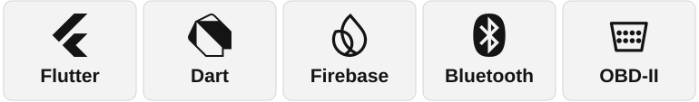
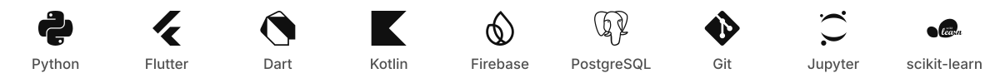

<picture>
  <source media="(prefers-color-scheme: dark)" srcset="assets/doodle/hero-dark.svg">
  <source media="(prefers-color-scheme: light)" srcset="assets/doodle/hero-light.svg">
  
</picture>

<picture>
  <source media="(prefers-color-scheme: dark)" srcset="assets/doodle/about-dark.svg">
  <source media="(prefers-color-scheme: light)" srcset="assets/doodle/about-light.svg">
  
</picture>

<h3>I'm a Computer Science graduate from Algeria, currently pursuing a Master's in Artificial Intelligence at Université Mustapha Stambouli, Mascara.</h3>

<h3>I'm interested in building mobile applications and using AI to solve practical problems.</h3>

 

<picture>
  <source media="(prefers-color-scheme: dark)" srcset="assets/doodle/project-dark.svg">
  <source media="(prefers-color-scheme: light)" srcset="assets/doodle/project-light.svg">
  
</picture>

<picture>
  <source media="(prefers-color-scheme: dark)" srcset="assets/doodle/insyt-dark.svg">
  <source media="(prefers-color-scheme: light)" srcset="assets/doodle/insyt-light.svg">
  
</picture>

<h3>Insyt is my graduation project — an intelligent vehicle health monitoring app.</h3>

It helps drivers understand their cars through real-time OBD-II data, diagnostic trouble codes and AI-assisted explanations.

<picture>
  <source media="(prefers-color-scheme: dark)" srcset="assets/doodle/insyt-stack-dark.svg">
  <source media="(prefers-color-scheme: light)" srcset="assets/doodle/insyt-stack-light.svg">
  
</picture>

 

<picture>
  <source media="(prefers-color-scheme: dark)" srcset="assets/doodle/tools-dark.svg">
  <source media="(prefers-color-scheme: light)" srcset="assets/doodle/tools-light.svg">
  
</picture>

<picture>
  <source media="(prefers-color-scheme: dark)" srcset="assets/mono/tools-dark.svg">
  <source media="(prefers-color-scheme: light)" srcset="assets/mono/tools-light.svg">
  
</picture>

 

<picture>
  <source media="(prefers-color-scheme: dark)" srcset="assets/doodle/currently-dark.svg">
  <source media="(prefers-color-scheme: light)" srcset="assets/doodle/currently-light.svg">
  
</picture>

<h3>Studying machine learning, knowledge representation and intelligent systems.</h3>

<h3>Improving Insyt and exploring mobile development.</h3>

<!-- Main title: Playfair Display Bold Italic (SIL Open Font License), converted to SVG outlines. Technology logos: https://github.com/simple-icons/simple-icons. Doodle motifs inspired by Lucide icons. -->
